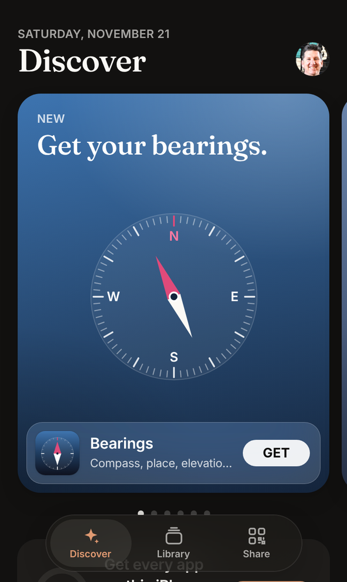
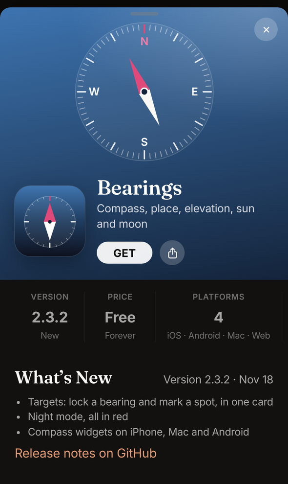
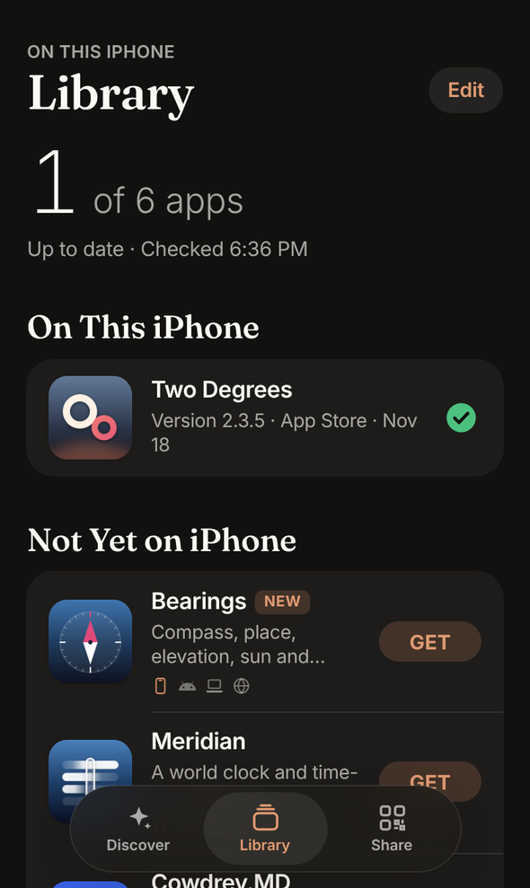

<p align="center"></p>

<h1 align="center">Cowdrey One</h1>
<p align="center"><b>Every app, one place.</b><br>
All of Bradley Cowdrey’s free apps, with the right download for the device you’re on: iPhone and iPad, Android, Mac or the web.<br>
Made by <a href="https://bradcowdrey.com">Bradley Cowdrey · bradcowdrey.com</a></p>

<p align="center">
  
  &nbsp;
  
  &nbsp;
  
</p>
<p align="center"></p>

---

**Not open source.** © 2026 Bradley Cowdrey. All rights reserved. This repository is private; see [LICENSE](LICENSE).
The apps it lists (Bearings, Two Degrees, Meridian, Cowdrey.MD, Cowdrey.PDF, Golden Hour) are open source under
the MIT License in their own repositories.

## What it does

- **Discover:** each app on its own sky, the way Two Degrees puts each city on its own: a headline, a glimpse of
  the app (a compass, °F and °C, live world clocks, a sunset, a page of Markdown, a signed PDF) and a Get button.
- **The right download, automatically.** Cowdrey One sees whether it’s on an iPhone or iPad, an Android phone, a
  Mac or another computer, and every Get button goes to the right place: the App Store, TestFlight, the Mac App
  Store, a signed `.dmg`, an APK, or the web app when there isn’t a version for that device. Settings can show the
  downloads for another device instead.
- **Get Every App:** a ring counts how many are on this device; Get All lists them with one tap each and a tip
  for the platform (App Store, Android’s install prompt, dragging into Applications).
- **Library:** the apps you got here, with the version and how; the ones not yet on this device; and **updates**
  for downloads (`.dmg` and APK) when a newer release appears on the app’s GitHub repository. The App Store keeps
  its own apps up to date. Edit removes an app from the list.
- **Each app’s page,** as in the App Store: version, price, platforms, category, privacy and developer; What’s New
  from the latest GitHub release; About and features; Get It On with every platform and requirement; and links to
  the product page, the source, issues and the Terms.
- **Get on Your Phone / Share:** a QR code to open Cowdrey One on a phone (on a Mac, “point your phone’s camera
  here”), Share and Copy Link, and how to keep Cowdrey One on the Home Screen, the Dock or the desktop.
- **Apple’s look in bradcowdrey.com’s colours:** cream, ink and clay, Fraunces for titles, the system font for
  everything else; a floating tab bar on phones and a sidebar on the Mac; sheets that slide up and pull down;
  light and dark, following the system or chosen in Settings.
- **Private:** no account, no ads, no analytics. The list of apps you got is kept in this browser or app only. The
  one request Cowdrey One makes itself is to GitHub’s public releases API, at most every six hours, for versions.
- First launch asks to agree to the [Terms of Use and Privacy](https://bradcowdrey.com/legal), as every app does.

## How it’s built

One web app in `web/`, with no build step and no dependencies at run time:

| Path | What it is |
|---|---|
| `web/catalog.js` | **The list of apps.** Add or change an app here; nothing else needs editing. |
| `web/index.html`, `app.css`, `app.js` | The interface: Discover, Library, Share, app pages, Get Every App. |
| `web/manifest.webmanifest`, `sw.js` | Install to the Home Screen, Dock or desktop, and open offline. |
| `web/apps/*.png` | Each app’s icon, cropped from its repository. |
| `web/fonts/fraunces.woff2`, `web/vendor/qrcode.js` | Fraunces (SIL Open Font License) and qrcode-generator (MIT). |
| `desktop/` | The **Tauri 2** shell that wraps `web/` as the Mac, iPhone, iPad and Android app, as for Cowdrey.MD and Cowdrey.PDF. |
| `design/icon.svg` | The icon’s source: the family’s “C”, as on Cowdrey.MD and Cowdrey.PDF, holding a grid of apps, in clay. |
| `tests/e2e.cjs` | Catalog checks and end-to-end tests as an iPhone, an Android phone and a Mac, in Chromium. |

### Add an app

Copy an entry in `web/catalog.js`, change it, and add its icon as `web/apps/<id>.png` (256 × 256, square, no
rounded corners: Cowdrey One rounds them). Each platform lists its ways to get the app, best first
(`appstore`, `testflight`, `macappstore`, `dmg`, `apk`, `web`). `npm test` checks every entry.

### Run it

```bash
npm start
```

Then open http://localhost:8080. The tests:

```bash
npm ci && npx playwright install chromium && npm test
```

## Getting it to people

| | How | Status |
|---|---|---|
| **Web, and installed from the browser** | `pages.yml` publishes `web/` to https://bradleycowdrey.github.io/cowdrey-one/ (the QR code’s address, `hubUrl` in `catalog.js`). From there it installs like an app: Safari’s Share → Add to Home Screen on iPhone and iPad, Install app on Android, File → Add to Dock on the Mac. | Works as soon as Pages is on. GitHub Pages for a **private** repository needs a paid GitHub plan; otherwise host `web/` elsewhere (bradcowdrey.com/one would suit) and change `hubUrl`. |
| **Mac** | `mac-app.yml` builds a universal `.dmg`, signed and notarized with the same six Developer ID secrets as the other apps. | Needs the secrets added to this repository. |
| **iPhone and iPad** | `ios-app.yml` builds, signs and uploads to TestFlight with the App Store Connect API key, as for Cowdrey.PDF. | Needs an App Store Connect record for `com.bradcowdrey.cowdreyone` and the key secrets. |
| **Android** | `android-app.yml` builds an APK and App Bundle, signed with the upload key secrets. | Needs the keystore secrets. |

This repository is private, so its GitHub release files can’t be downloaded by the public. Once a Mac, Android or
iPhone build has a public home (the App Store, TestFlight’s public link, or a public download), put its link in
`hubDownloads` in `catalog.js` and the Share screen offers it.

Secrets, as in the other repositories (Settings → Secrets and variables → Actions): `DEVELOPER_ID_P12`,
`DEVELOPER_ID_P12_PASSWORD`, `CODESIGN_IDENTITY`, `NOTARY_APPLE_ID`, `NOTARY_PASSWORD`, `NOTARY_TEAM_ID`;
`APP_STORE_CONNECT_API_KEY`, `APP_STORE_CONNECT_KEY_ID`, `APP_STORE_CONNECT_ISSUER_ID`; `ANDROID_KEYSTORE`,
`ANDROID_KEYSTORE_PASSWORD`, `ANDROID_KEY_ALIAS`.

## Before the first release

- **Terms:** add Cowdrey One to `TERMS.md` in cowdrey-md (Sections 6, 15 and 25), and note in Sections 1, 7 and
  19 that Cowdrey One’s code is not under the MIT License. Then sync the copy here.
- **App Review:** an iPhone app that mostly links to other apps can be turned down under Guideline 4.2 (minimum
  functionality). The web app, installed from Safari, needs no review.
- **Version:** one number in `desktop/src-tauri/tauri.conf.json`, `Cargo.toml`, `desktop/package.json` and
  `VERSION` in `web/app.js` (the build stops if they differ), with an entry in [CHANGELOG.md](CHANGELOG.md).
