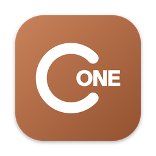
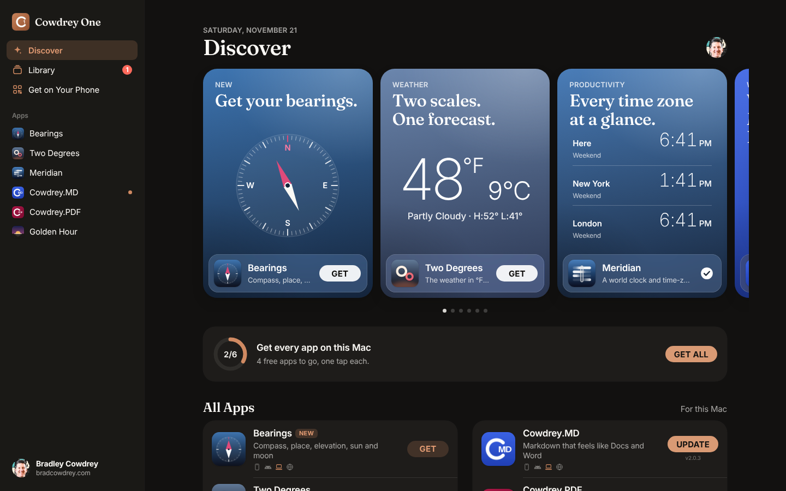

<p align="center"></p>

<h1 align="center">Cowdrey One</h1>
<p align="center"><b>Every app, one place.</b><br>
All of Bradley Cowdrey’s free apps, with the right download for the device you’re on: iPhone and iPad, Android, Mac or the web.<br>
Made by <a href="https://bradcowdrey.com">Bradley Cowdrey · bradcowdrey.com</a></p>

<p align="center">
  
  &nbsp;
  
  &nbsp;
  
</p>
<p align="center"></p>

---

**Free and open source** under the [MIT License](LICENSE), © 2026 Bradley Cowdrey, like every app it lists (Bearings,
Two Degrees, Meridian, Cowdrey.MD, Cowdrey.PDF and Golden Hour), each in its own repository.

## What it does

- **Discover:** each app on a card of its own with a Get button. An app on the App Store shows its first App Store
  screenshot, as the App Store does; Golden Hour, on the web, shows a drawn sunset.
- **The right download, automatically.** Cowdrey One sees whether it’s on an iPhone or iPad, an Android phone, a
  Mac or another computer, and every Get button goes to the right place: the App Store, TestFlight, the Mac App
  Store, a signed `.dmg`, an APK, or the web app when there isn’t a version for that device. Settings can show the
  downloads for another device instead.
- **Get Every App:** one button gets every app, as far as each platform allows (in the Mac and Android apps, a ring
  counts how many are installed):

  | | In a browser | In the Cowdrey One app |
  |---|---|---|
  | **Mac** | **Download All**: every `.dmg` at once, to drag into Applications | **Install All**: downloads each app, checks it’s signed by Bradley Cowdrey’s Apple team, and puts it in Applications. One click. |
  | **Android** | **Download All**: every APK at once, to open and install | **Install All**: hands each APK to Android, which asks “Install?” once per app. Updates to apps it installed go ahead without asking (Android 12 and later). |
  | **iPhone and iPad** | One tap per app: each opens the App Store | **Get All**: each app’s App Store page opens inside Cowdrey One in turn; tap Get, then Done. iOS never lets one app install another. |

  The Mac and Android apps also see which apps are really installed, and their versions, and offer **Open**.
- **Only what’s really installed.** Cowdrey One never marks an app as installed because Get was tapped: opening the
  App Store or starting a download doesn’t mean the app was installed. The Mac and Android apps see every app. iOS
  doesn’t let one app see which others are installed, so the iPhone app can only ask whether an app’s own link (its
  URL scheme, `scheme` in `catalog.js`) opens: today that’s Two Degrees (`twodegrees://`). An app that adds a URL
  scheme, with it in `catalog.js`, is seen too. A browser sees none, so it shows Get for every app.
- **Library:** the apps Cowdrey One sees on this device, with Open; the rest, with Get; and, in the Mac and Android
  apps, **updates** for downloads (`.dmg` and APK) when a newer release appears on the app’s GitHub repository. The
  App Store keeps its own apps up to date.
- **Each app’s page,** as in the App Store: its App Store screenshots in a row you swipe; version, price,
  platforms, category, privacy and developer; What’s New from the latest GitHub release (the words about the app,
  without the download tables, links and checksums); About and features; Get It On with every platform and requirement; and links to
  the product page, the source, issues and the Terms.
- **Get on Your Phone / Share:** a QR code to open Cowdrey One on a phone (on a Mac, “point your phone’s camera
  here”), Share and Copy Link, and how to keep Cowdrey One on the Home Screen, the Dock or the desktop.
- **Apple’s look in bradcowdrey.com’s colours:** cream, ink and clay, Fraunces for titles, the system font for
  everything else; a floating tab bar on phones and a sidebar on the Mac; sheets that slide up and pull down;
  light and dark, following the system or chosen in Settings.
- **Private:** no account, no ads, no analytics. What it sees installed stays on this device. The one request
  Cowdrey One makes itself is to GitHub’s public releases API, at most every six hours, for versions.
- First launch asks to agree to the [Terms of Use and Privacy](https://bradcowdrey.com/legal), as every app does.

## How it’s built

One web app in `web/`, with no build step and no dependencies at run time:

| Path | What it is |
|---|---|
| `web/catalog.js` | **The list of apps.** Add or change an app here; nothing else needs editing. |
| `web/index.html`, `app.css`, `app.js` | The interface: Discover, Library, Share, app pages, Get Every App. |
| `web/manifest.webmanifest`, `sw.js` | Install to the Home Screen, Dock or desktop, and open offline. |
| `web/apps/*.png` | Each app’s icon, cropped from its repository. |
| `web/apps/shots/*.webp` | Each App Store app’s iPhone App Store screenshots, 600 px wide, from its repository: Cowdrey.PDF and Cowdrey.MD `docs/app-store`, Two Degrees `appstore/screenshots`, and Meridian and Bearings the `ci-appstore` branch their App Store workflow writes. |
| `web/fonts/fraunces.woff2`, `web/vendor/qrcode.js` | Fraunces (SIL Open Font License) and qrcode-generator (MIT). |
| `desktop/` | The **Tauri 2** shell that wraps `web/` as the Mac, iPhone, iPad and Android app, as for Cowdrey.MD and Cowdrey.PDF. |
| `desktop/src-tauri/src/mac.rs` | The Mac installer: finds installed apps and versions, and installs a `.dmg` with one click. |
| `desktop/src-tauri/plugins/installer` | The iPhone and Android installer: Android’s package installer (Kotlin) and the App Store page inside the app (Swift). |
| `design/icon.svg` | The icon’s source: the family’s “C” with ONE, set exactly as Cowdrey.MD and Cowdrey.PDF set MD and PDF, in clay. |
| `tests/e2e.cjs` | Catalog checks and end-to-end tests as an iPhone, an Android phone and a Mac, in Chromium. |
| `tests/app-store-screens.mjs`, `design/app-store/` | Cowdrey One’s App Store screenshots (`npm run screens`): the real app on iPhone, iPad and Mac in dark mode, five of each, framed on the Cowdrey family standard (`design/app-store/README.md`) in `docs/app-store`. |
| `design/app-store/` | The Cowdrey family’s App Store screenshot standard: the master template every app copies, its fonts and [the rules](design/app-store/README.md). |

### Add an app

Copy an entry in `web/catalog.js`, change it, and add its icon as `web/apps/<id>.png` (256 × 256, square, no
rounded corners: Cowdrey One rounds them). For an app on the App Store, add its iPhone App Store screenshots as
`web/apps/shots/<id>-1.webp`, `-2.webp` and so on (600 px wide) and set `shots` to how many there are. Each platform lists its ways to get the app, best first
(`appstore`, `testflight`, `macappstore`, `dmg`, `apk`, `web`). `npm test` checks every entry.

### Run it

```bash
npm start
```

Then open http://localhost:8080. The tests:

```bash
npm ci && npx playwright install chromium && npm test
```

## Getting it to people

| | How | Status |
|---|---|---|
| **Web, and installed from the browser** | `pages.yml` publishes `web/` to https://bradleycowdrey.github.io/cowdrey-one/ (the QR code’s address, `hubUrl` in `catalog.js`). From there it installs like an app: Safari’s Share → Add to Home Screen on iPhone and iPad, Install app on Android, File → Add to Dock on the Mac. | Works once Pages publishes from Actions: Settings → Pages → Source: **GitHub Actions** (the workflow’s own token can’t turn Pages on). |
| **Mac** | `mac-app.yml` builds a universal `.dmg`, signed and notarized with the same six Developer ID secrets as the other apps. | Needs the secrets added to this repository. |
| **iPhone and iPad** | `ios-app.yml` builds, signs and uploads to TestFlight with the App Store Connect API key, as for Cowdrey.PDF; it registers the bundle ID `com.bradcowdrey.cowdreyone` if needed. Then `testflight-public.yml` adds the build to the “Public” tester group, sends it to beta App Review and prints the public TestFlight link. | Needs the key secrets, and an App Store Connect app record (Apps, +, New App: Cowdrey One, bundle ID `com.bradcowdrey.cowdreyone`, SKU `cowdrey-one`). Listing and review notes: `docs/app-store/listing.json`; screenshots (iPhone 6.9", iPad 13" and Mac): `docs/app-store/*.png`, from `npm run screens` on the [family standard](design/app-store/README.md); each run of `ios-app.yml` also makes them, for review only. |
| **Android** | `android-app.yml` builds the APK, signed with the upload key secrets, for the GitHub release. | Needs the keystore secrets. |
| **Google Play** | The same workflow builds the Google Play version as an App Bundle (`STORE=play`): each app comes from its Google Play page, with no APKs and no Install All. Runs started by hand on `main` send it to the closed test; `play-listing.yml` sends the store listing in `docs/play`. | Closed test, coming soon. Needs `PLAY_SERVICE_ACCOUNT_JSON` and the keystore secrets; Play Console steps and App content answers in [docs/play/README.md](docs/play/README.md). |

The GitHub releases are public, and `hubDownloads` in `catalog.js` lists Cowdrey One’s own downloads for the Share
screen: the public TestFlight link and the latest release’s APK now (in the Google Play version, its Play page
instead of the APK); the `.dmg` once it’s signed and notarized.

Secrets, as in the other repositories (Settings → Secrets and variables → Actions): `DEVELOPER_ID_P12`,
`DEVELOPER_ID_P12_PASSWORD`, `CODESIGN_IDENTITY`, `NOTARY_APPLE_ID`, `NOTARY_PASSWORD`, `NOTARY_TEAM_ID`;
`APP_STORE_CONNECT_API_KEY`, `APP_STORE_CONNECT_KEY_ID`, `APP_STORE_CONNECT_ISSUER_ID`; `ANDROID_KEYSTORE` (the
upload keystore as base64: `base64 -i ~/cowdrey-upload.jks | pbcopy`; `ANDROID_KEYSTORE_B64`, Bearings' name, works
too), `ANDROID_KEYSTORE_PASSWORD` and `ANDROID_KEY_ALIAS`, plus `ANDROID_KEY_PASSWORD` only if the key's password
differs from the keystore's.

## Before the first release

- **Terms:** add Cowdrey One to `TERMS.md` in cowdrey-md (Sections 6, 15 and 25), like the other apps; its code is
  under the MIT License like theirs. Then sync the copy here.
- **App Review:** an iPhone app that mostly links to other apps can be turned down under Guideline 4.2 (minimum
  functionality). The web app, installed from Safari, needs no review. The iPhone app leaves Android out of its
  screens, as App Review asks.
- **Google Play:** Play doesn’t allow an app to install other apps, so the Android app with Install All is for
  direct download (an APK), like the other apps’ Android versions. The Google Play version, a separate build of
  the same app, links to each app’s Play page instead ([docs/play/README.md](docs/play/README.md)).
- **Version:** one number in `desktop/src-tauri/tauri.conf.json`, `Cargo.toml`, `desktop/package.json` and
  `VERSION` in `web/app.js` (the build stops if they differ), with an entry in [CHANGELOG.md](CHANGELOG.md).
